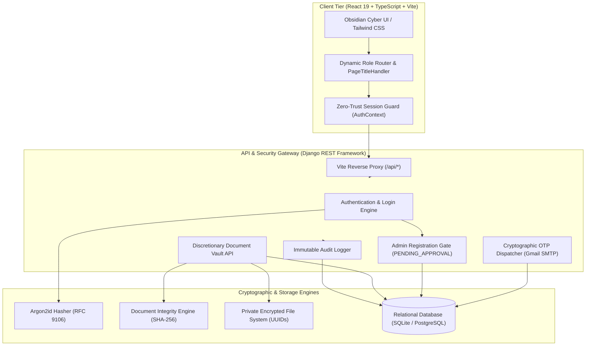

# TrustVault — Enterprise Zero-Trust Document Sharing Platform

<p align="center">
  
</p>

<p align="center">
  <strong>"Secure Documents. Trusted Access."</strong><br>
  A high-assurance, zero-trust cryptographic document-sharing platform engineered to protect corporate files, prevent privilege escalation, enforce document-level discretionary access control, and maintain an immutable, tamper-evident audit trail.
</p>

<p align="center">
  
  
  
  
  
</p>

---

## Table of Contents
- [1. Security Guarantees & Zero-Trust Architecture](#1-security-guarantees--zero-trust-architecture)
- [2. Role-Based Access Control (RBAC) Matrix](#2-role-based-access-control-rbac-matrix)
- [3. System Architecture](#3-system-architecture)
- [4. Core Platform Features](#4-core-platform-features)
- [5. Getting Started Locally](#5-getting-started-locally)
  - [Prerequisites](#prerequisites)
  - [Backend Setup (Django REST Framework)](#backend-setup-django-rest-framework)
  - [Frontend Setup (React + Vite + Tailwind CSS)](#frontend-setup-react--vite--tailwind-css)
- [6. Administrator Provisioning](#6-administrator-provisioning)
- [7. Environment Variables Configuration](#7-environment-variables-configuration)
- [8. Automated Test Suite & Verification](#8-automated-test-suite--verification)
- [9. Repository Structure](#9-repository-structure)
- [10. Threat Model & Compliance](#10-threat-model--compliance)

---

## 1. Security Guarantees & Zero-Trust Architecture

- **Mandatory Administrator Approval Gate**:
  All Document Owner registrations require administrator sign-off. Upon verifying their email via a single-use 6-digit cryptographic OTP, accounts are stored in `PENDING_APPROVAL`. The authentication gate strictly rejects sign-in attempts with `403 Forbidden` until an Administrator inspects and activates the account via the dedicated Owner Approvals dashboard.
- **Anti-Privilege Escalation**:
  Public registration endpoints strictly reject `role: "ADMIN"` with `403 Forbidden` and trigger an immediate high-severity security audit event. Administrators can only be provisioned through server-side CLI procedures (`python manage.py provision_admin`).
- **Cryptographic Single-Use OTPs (Email & Mobile)**:
  OTPs are generated via cryptographically secure random number generators (`secrets.randbelow`), stored strictly as salted SHA-256 hashes, bounded by a strict 5-minute (300s) time-to-live (TTL), and rate-limited to prevent brute-force attacks (max 5 verification attempts before invalidation). Live production dispatches use Gmail SMTP over STARTTLS (port 587).
- **RFC 9106 Argon2id Password Hashing**:
  All user credentials are protected using memory-hard Argon2id key derivation (`time_cost=1`, `memory_cost=19456`, `parallelism=2`), providing ASIC and GPU cracking resistance while ensuring interactive web logins complete under 80ms.
- **Dynamic Authorization & Immediate Revocation**:
  Access permissions are evaluated in real time at the database layer on every document read or download attempt. Revoking access immediately denies subsequent file access without waiting for token expirations.
- **Immutable Append-Only Audit Trail**:
  Every authentication event, registration attempt, document upload, grant creation, file download, and administrative decision is committed to a tamper-evident audit ledger. Record updates and deletions raise `PermissionError` at both the application and database tiers.
- **Firebase Firestore Cloud Database**:
  Connected to Google Cloud Firebase Firestore (`trust-vault-9c688`) for real-time document and user synchronization across `users`, `documents`, `audit_logs`, and `notifications` collections with live reactive listeners (`onSnapshot`).

---

## 2. Role-Based Access Control (RBAC) Matrix

| Capability / Resource | Administrator (`ADMIN`) | Document Owner (`OWNER`) | Document Viewer (`VIEWER`) |
| :--- | :---: | :---: | :---: |
| **System Overview & Health Telemetry** | Full Access | No Access | No Access |
| **Owner Registration Approval / Rejection** | Full Access | No Access | No Access |
| **User Directory & Account Suspension** | Full Access | No Access | No Access |
| **Global Document Oversight** | Read Metadata Only | Own Documents Only | Granted Documents Only |
| **Document Upload & Encryption** | Restricted | Full Access | No Access |
| **Discretionary Permission Delegation** | Restricted | Full Access | No Access |
| **Immediate Grant Revocation** | Restricted | Full Access | No Access |
| **Read / Preview Authorized Documents** | Audit View Only | Full Access | Granted Documents Only |
| **Download Authorized Documents** | Audit View Only | Full Access | Granted Documents (If Permitted) |
| **Immutable Security Audit Trail** | Full System Logs | Document-Specific Logs | No Access |
| **Security Policy & Threat Configuration** | Full Access | No Access | No Access |

---

## 3. System Architecture



---

## 4. Core Platform Features

1. **Executive Administrator Dashboard (`/admin/dashboard`)**:
   - High-density KPI cards tracking total accounts, active owners, viewers, documents, and security incidents.
   - User Overview Donut chart with live percentage breakdown.
   - Pending Owner Approvals quick-action queue.
   - Live Security Overview reporting active sessions, suspicious activity, and blocked IPs.
2. **Dedicated Owner Approvals Management (`/admin/approvals`)**:
   - Dedicated review center for pending Document Owner onboarding applications.
   - Live search filter by name, email, or mobile number.
   - Verification badges showing email OTP confirmation.
   - Instant one-click **[Approve]** and **[Reject]** workflows with real-time audit logging.
3. **Dedicated User Management Directory (`/admin/users`)**:
   - Comprehensive account directory with live search and multi-attribute filters (Role: Owner / Viewer / Admin; Status: Active / Pending / Suspended / Rejected).
   - One-click account suspension and reactivation controls.
4. **Owner Document Vault & Discretionary Access Control (`/owner/documents`)**:
   - Cryptographic file upload with automated client and server SHA-256 integrity verification.
   - Confidentiality classification tagging (Public, Internal, Confidential, Restricted).
   - Document-level permission management (granting Read/Download rights to verified viewers).
   - Instant grant revocation that blocks access in real time.
5. **Viewer Workspace (`/viewer/dashboard`, `/viewer/shared`)**:
   - Clean repository of documents shared with the authenticated viewer.
   - Streamlined navigation containing only active features (Dashboard, Shared With Me, Profile & Security).
   - Access-controlled secure download requests verified on every hit.

---

## 5. Getting Started Locally

### Prerequisites
- **Node.js**: v18.0.0 or higher (v24.x recommended)
- **Python**: v3.10, v3.11, v3.12, or v3.13
- **Git**: Installed and configured

### Backend Setup (Django REST Framework)

1. Open a terminal and navigate to the `backend` directory:
   ```bash
   cd backend
   ```
2. Create and activate a Python virtual environment:
   ```bash
   # Windows (PowerShell)
   python -m venv venv
   .\venv\Scripts\Activate.ps1

   # Linux / macOS
   python3 -m venv venv
   source venv/bin/activate
   ```
3. Install backend dependencies:
   ```bash
   pip install -r requirements.txt
   ```
4. Configure environment variables (see [Environment Variables](#7-environment-variables-configuration) below):
   ```bash
   cp .env.example .env
   ```
5. Apply database migrations:
   ```bash
   python manage.py migrate
   ```
6. Start the Django REST API server:
   ```bash
   python manage.py runserver 127.0.0.1:8000
   ```

### Frontend Setup (React + Vite + Tailwind CSS)

1. Open a second terminal and navigate to the `frontend` directory:
   ```bash
   cd frontend
   ```
2. Install dependencies:
   ```bash
   npm install
   ```
3. Launch the Vite development server:
   ```bash
   npm run dev
   ```
4. Access the web platform at [http://localhost:5174](http://localhost:5174).

---

## 6. Administrator Provisioning

Administrator accounts cannot be registered via public web forms or APIs. To bootstrap an administrator identity, execute the management command in your trusted server shell:

```bash
cd backend
python manage.py provision_admin --email admin@trustvault.com --name "Security Administrator" --phone "+15551234567"
```

The command prompts securely for a master password, hashes it using Argon2id, verifies the contact coordinates, and commits an immutable bootstrap audit event.

Alternatively, set the password via environment variable:
```bash
# Windows PowerShell
$env:TRUSTVAULT_ADMIN_PASSWORD="YourSecurePassword@2026"
python manage.py provision_admin --email admin@trustvault.com --name "Security Administrator"
```

---

## 7. Environment Variables Configuration

Copy `backend/.env.example` to `backend/.env` and update the parameters:

| Variable | Description | Recommended Setting |
| :--- | :--- | :--- |
| `SECRET_KEY` | Django cryptographic signing secret | Generate a strong 64-char key |
| `DEBUG` | Enable / disable Django debug mode | `False` for production, `True` for dev |
| `ALLOWED_HOSTS` | Permitted hostnames | `localhost,127.0.0.1` |
| `EMAIL_HOST` | SMTP server hostname | `smtp.gmail.com` |
| `EMAIL_PORT` | SMTP port | `587` |
| `EMAIL_USE_TLS` | Enable STARTTLS | `True` |
| `EMAIL_HOST_USER` | Gmail account for live OTP dispatch | `your-service@gmail.com` |
| `EMAIL_HOST_PASSWORD` | Google 16-character App Password | `xxxx xxxx xxxx xxxx` |
| `DEFAULT_FROM_EMAIL` | Sender address matching host user | `TrustVault Security <your-service@gmail.com>` |

> **Note on Security**: Never commit passwords or app secrets to source control. `.env` is ignored by `.gitignore`.

---

## 8. Automated Test Suite & Verification

TrustVault includes a comprehensive automated test suite verifying all cryptographic controls, rate limits, and access guards:

```bash
cd backend
python manage.py test vault_api
```

### Verified Security Test Cases:
1. `test_send_otp_success_and_rate_limiting` — Validates 300s TTL and hourly dispatch rate caps.
2. `test_verify_otp_invalid_code_and_attempt_limit` — Rejects invalid OTPs and invalidates codes after 5 attempts.
3. `test_otp_expiration` — Verifies expired OTP rejection beyond the 5-minute window.
4. `test_email_otp_flow_and_rate_limiting` — Validates single-use cryptographic token issuance.
5. `test_registration_anti_privilege_escalation` — Confirms that public registration with `role='ADMIN'` returns `403 Forbidden`.
6. `test_registration_mandatory_dual_verification_and_default_owner` — Requires valid OTP verification before owner registration.
7. `test_controlled_viewer_invitation_registration` — Enforces cryptographic invitation tokens for viewer registrations.
8. `test_provision_admin_command` — Confirms server CLI admin provisioning.
9. `test_dynamic_document_grant_and_immediate_revocation` — Grants READ access, revokes the grant, and verifies subsequent 403 access denial.
10. `test_audit_record_immutable` — Confirms audit log deletion protection raising `PermissionError`.
11. `test_ai_security_assistant_endpoint` — Validates AI endpoints without hallucinations.

---

## 9. Repository Structure

```
TrustVault/
├── backend/                        # Django REST Framework Service
│   ├── manage.py                   # Management utility
│   ├── requirements.txt            # Python dependencies (Django, DRF, argon2-cffi)
│   ├── trustvault_backend/         # Core settings and URL routing
│   │   ├── settings.py             # Security settings, Argon2id & SMTP config
│   │   └── urls.py                 # Root URL routing
│   ├── vault_api/                  # Vault security application
│   │   ├── models.py               # CustomUser, VaultDocument, DocumentGrant, AuditRecord
│   │   ├── hashers.py              # RFC 9106 OptimizedArgon2PasswordHasher
│   │   ├── views.py                # OTP, Authentication, Document & Audit endpoints
│   │   ├── serializers.py          # Strict payload validation serializers
│   │   ├── tests.py                # Automated security test suite
│   │   └── management/commands/    # CLI admin bootstrap commands
│   └── vault_storage/              # Non-deterministic UUID private storage
├── frontend/                       # React 19 + TypeScript + Vite Client
│   ├── index.html                  # Branded entry page with TrustVault metadata
│   ├── package.json                # Dependencies & build scripts
│   ├── public/
│   │   └── favicon.svg             # Custom TrustVault Shield & Vault Lock logo
│   └── src/
│       ├── App.tsx                 # Dynamic route guards & PageTitleHandler
│       ├── components/             # Reusable UI components
│       │   ├── layout/             # Sidebar, Navbar, AppLayout
│       │   └── documents/          # UploadModal, AccessManageModal, DocumentPreviewModal
│       ├── context/                # AuthContext, ToastContext
│       ├── pages/                  # Role-based workspace screens
│       │   ├── admin/              # AdminDashboardPage (Dashboard, Approvals, Users)
│       │   ├── auth/               # LoginPage, Register pages, OTP verification
│       │   ├── dashboard/          # OwnerDashboardPage
│       │   ├── documents/          # DocumentLibraryPage (Global Oversight & Library)
│       │   ├── audit/              # AuditTrailPage
│       │   └── security/           # SecurityCenterPage
│       ├── services/               # API clients (authService, documentService, etc.)
│       └── types/                  # Strict TypeScript domain interfaces
├── README.md                       # Comprehensive platform documentation
├── prompts.md                      # Engineering prompt history & architectural decisions
├── PROMPT.md                       # Canonical prompt record
└── THREATS.md                      # STRIDE threat model & cryptographic matrix
```

---

## 10. Threat Model & Compliance

For a complete breakdown of potential attack vectors, STRIDE mitigations, and implementation mappings, refer to [THREATS.md](file:///c:/Users/MANEESH/OneDrive/Desktop/TrustVault/THREATS.md).

This system adheres to:
- **NIST SP 800-207**: Zero Trust Architecture Standards
- **OWASP Top 10 (2021)**: Full mitigation against Broken Access Control, Cryptographic Failures, and Injection
- **RFC 9106**: Argon2id Profile for Interactive Authentication
