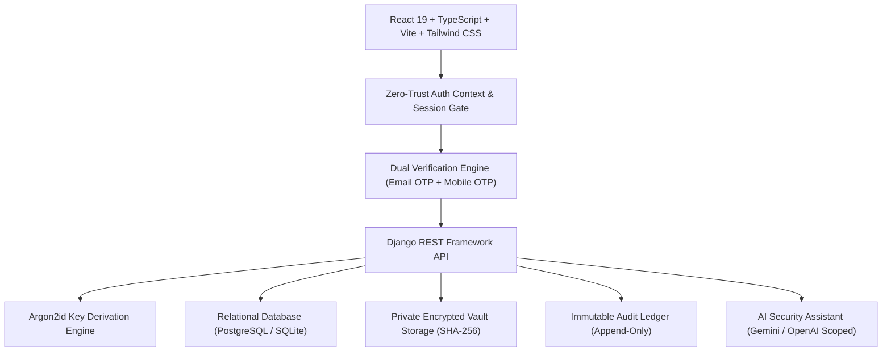

# TrustVault — Enterprise Zero-Trust Document Sharing Platform

> **"Your Documents. Your Control."**  
> A high-assurance, cryptographic document-sharing platform designed to protect confidential files, prevent unauthorized access, enforce document-level permissions, and maintain a tamper-evident audit trail.

---

## 1. Zero-Trust Security Guarantees & Anti-Patterns Rejected

- **Zero Mock Data Policy**: No synthetic metrics, fake API responses, mock accounts, or fabricated security events. All dashboard counts, users, and audit events originate from live database records. Genuine empty states are displayed when no records exist.
- **Strict Role Separation**: Exactly three roles are supported:
  1. `ADMIN` (Security Administrator) — System-wide audit visibility, threat monitoring, user management, and platform health.
  2. `OWNER` (Document Owner) — Discretionary access control, upload/encryption of sensitive files, share management, and revocation.
  3. `VIEWER` (Document Viewer) — Restricted read/view access strictly bounded by active grants.
- **Anti-Privilege Escalation**:
  - Public registration contains **no role selector**.
  - All public signups default strictly to `OWNER`.
  - Direct registration as `VIEWER` requires a cryptographically validated, server-issued invitation token (`?invite=...`).
  - Administrator accounts **cannot be created via public UI or public API endpoints**. Attempting to pass `role: "ADMIN"` triggers an immutable security audit event and returns `403 Forbidden`.
  - Administrator provisioning is restricted to a server-side CLI procedure (`python manage.py provision_admin`).
- **Mandatory Dual OTP Verification**:
  - Accounts require verification of **both** corporate Email (6-digit OTP, 5-minute TTL) and Mobile cellular number (6-digit OTP, 5-minute TTL) before account activation.
  - OTPs are stored exclusively as salted SHA-256 hashes with strict attempt limits (max 5) and rate limits (max 3 dispatches per window).
- **Argon2id Password Hashing**: All passwords use memory-hard Argon2id key derivation, resilient against GPU and ASIC cracking.
- **Dynamic Authorization & Immediate Revocation**: Every document read or download operation validates grants against the relational store in real-time. Revoking a grant immediately denies subsequent download requests.
- **Append-Only Tamper-Evident Audit Trail**: Audit records are immutable. Deletions and modifications are rejected at both application and database layers.

---

## 2. System Architecture



---

## 3. Provisioning the Initial Administrator

Administrator accounts can only be provisioned through trusted server environments:

```bash
cd backend
python manage.py provision_admin --email admin@trustvault.com --name "Security Administrator" --phone "+15551234567"
```

The command will securely prompt for the master password, hash it with Argon2id, mark both email and mobile numbers verified, and log an immutable bootstrap audit event.

Alternatively, supply the password via environment variable:
```bash
$env:TRUSTVAULT_ADMIN_PASSWORD="YourSecurePassword@2026"
python manage.py provision_admin --email admin@trustvault.com --name "Security Administrator"
```

---

## 4. Running the Platform Locally

### Backend (Django REST Framework)
```bash
cd backend
python -m venv venv
.\venv\Scripts\Activate.ps1
pip install -r requirements.txt
python manage.py migrate
python manage.py runserver 127.0.0.1:8000
```

### Frontend (React + Vite + Tailwind)
```bash
cd frontend
npm install
npm run dev
```
Open [http://localhost:5174](http://localhost:5174) in your browser.

---

## 5. Environment Variables Configuration

Copy `backend/.env.example` to `backend/.env`:

| Variable | Description | Default / Mode |
| :--- | :--- | :--- |
| `SECRET_KEY` | Django cryptographic signing secret | `django-insecure-...` |
| `DEBUG` | Development debug flag | `True` |
| `ALLOWED_HOSTS` | Permitted server hostnames | `*` |
| `GEMINI_API_KEY` | Google Gemini API Key for AI Security Assistant | Optional (clean fallback alert if missing) |
| `OPENAI_API_KEY` | OpenAI API Key (alternative AI provider) | Optional |
| `EMAIL_HOST` | SMTP server for live email delivery | Optional (falls back to secure console) |
| `TWILIO_ACCOUNT_SID` | Twilio SMS gateway for live cellular OTP | Optional (falls back to dev console) |

---

## 6. Automated Security & Verification Test Suite

TrustVault includes automated unit and integration tests covering all zero-trust guarantees:

```bash
cd backend
python manage.py test vault_api
```

### Verified Test Cases:
1. `test_send_otp_success_and_rate_limiting` — Enforces 300-second TTL and window dispatch caps.
2. `test_verify_otp_invalid_code_and_attempt_limit` — Enforces maximum 5 attempts before invalidation.
3. `test_otp_expiration` — Rejects expired codes beyond TTL.
4. `test_email_otp_flow_and_rate_limiting` — Validates single-use cryptographic tokens.
5. `test_registration_anti_privilege_escalation` — Rejects public `role='ADMIN'` registration with 403.
6. `test_registration_mandatory_dual_verification_and_default_owner` — Requires both verification tokens and assigns `OWNER`.
7. `test_controlled_viewer_invitation_registration` — Allows viewer registration strictly via invitation tokens.
8. `test_provision_admin_command` — Verifies trusted server CLI bootstrapping.
9. `test_dynamic_document_grant_and_immediate_revocation` — Grants READ access, then revokes and verifies subsequent 403 denial.
10. `test_audit_record_immutable` — Asserts that audit records cannot be deleted (`PermissionError`).
11. `test_ai_security_assistant_endpoint` — Validates unconfigured API key handling without hallucinations.

---

## 7. License & Compliance
This software adheres to NIST SP 800-207 Zero-Trust Architecture standards and GDPR / SOC2 data governance guidelines.
