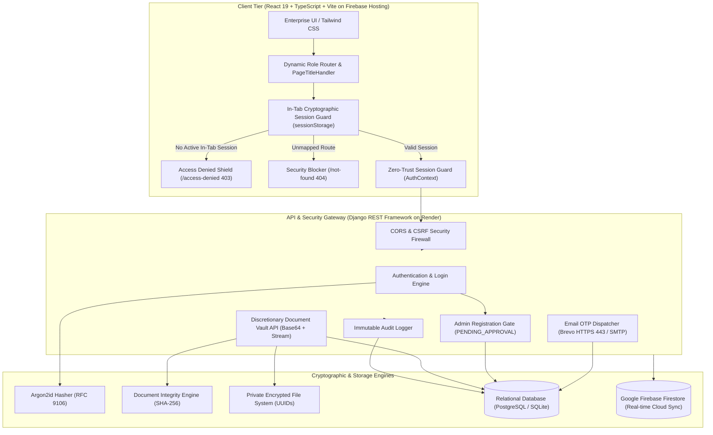

# TrustVault — Enterprise Zero-Trust Document Sharing Platform

<p align="center">
  
</p>

<p align="center">
  <strong>"Secure Documents. Trusted Access."</strong><br>
  A high-assurance, zero-trust cryptographic document-sharing platform engineered to protect enterprise assets, prevent privilege escalation, enforce document-level discretionary access control, and maintain an immutable, tamper-evident audit trail.
</p>

<p align="center">
  
  
  
  
  
  
  
</p>

---

## Live Deployments & Endpoints

- **Live Frontend (Firebase Hosting)**: [https://trust-vault-9c688.web.app](https://trust-vault-9c688.web.app)
- **Secondary Firebase Domain**: [https://trust-vault-9c688.firebaseapp.com](https://trust-vault-9c688.firebaseapp.com)
- **Live Backend API (Render Cloud)**: [https://trustvault-backend-jmrw.onrender.com](https://trustvault-backend-jmrw.onrender.com)
- **GitHub Repository**: [https://github.com/Maneesh724/TrustVault.git](https://github.com/Maneesh724/TrustVault.git)

---

## Table of Contents
- [1. Security Guarantees & Zero-Trust Architecture](#1-security-guarantees--zero-trust-architecture)
- [2. Role-Based Access Control (RBAC) Matrix](#2-role-based-access-control-rbac-matrix)
- [3. System Architecture](#3-system-architecture)
- [4. Core Platform Features](#4-core-platform-features)
- [5. Getting Started Locally](#5-getting-started-locally)
  - [Prerequisites](#prerequisites)
  - [Backend Setup (Django REST Framework)](#backend-setup-django-rest-framework)
  - [Frontend Setup (React + Vite + Tailwind CSS)](#frontend-setup-react--vite--tailwind-css)
- [6. Administrator Provisioning](#6-administrator-provisioning)
- [7. Environment Variables Configuration](#7-environment-variables-configuration)
  - [Brevo HTTPS API (Recommended for Cloud Hosts)](#brevo-https-api-recommended-for-cloud-hosts)
  - [SMTP Fallback Configuration](#smtp-fallback-configuration)
- [8. Automated Test Suite & Verification](#8-automated-test-suite--verification)
- [9. Repository Structure](#9-repository-structure)
- [10. Threat Model & Compliance](#10-threat-model--compliance)

---

## 1. Security Guarantees & Zero-Trust Architecture

- **Global Zero-Trust Route Lock-Down & In-Tab Session Isolation**:
  Protected routes (`/admin/*`, `/owner/*`, `/viewer/*`, `/documents`) strictly require an explicit cryptographic in-tab session token (`trustvault_active_session` in `sessionStorage`). Direct URL deep-linking or cold navigation without an active in-tab sign-in immediately aborts with an HTTP 403 Forbidden redirect to [`/access-denied`](https://trust-vault-9c688.web.app/access-denied), preventing background cookie poisoning and credential leakage. Unmapped paths route to a hardened HTTP 404 security blocker.
- **Relational Binary Persistence & Non-Volatile Streaming**:
  Documents are redundantly persisted both as Base64 binaries in the relational database (`VaultDocument.file_content`) and as non-deterministic UUIDs on disk. This guarantees that ephemeral cloud container restarts (such as Render or Docker redeployments) never lose uploaded document binaries or corrupt PDF streams.
- **Authorized Document Deletion & Lifecycle Governance**:
  Document Owners and Administrators can permanently expunge documents via `DELETE /api/documents/<id>/` or `POST /api/documents/<id>/delete/`. Deletions perform a verified atomic purge: revoking active grants, deleting database records, removing underlying filesystem binaries, synchronizing real-time Firestore state, and recording an immutable `DOC_DELETE` audit event.
- **Dual-Mode High-Assurance Email OTP Dispatch**:
  OTPs are generated via cryptographically secure random number generators (`secrets.randbelow`), stored as salted SHA-256 hashes with a 5-minute (300s) TTL, and capped at 5 invalid verification attempts. In cloud production (Render), outbound SMTP ports (25/465/587) are firewalled; TrustVault uses **Brevo HTTPS REST API (Port 443)** for guaranteed global delivery, with automatic fallback to standard SMTP.
- **RFC 9106 Argon2id Password Hashing**:
  All user credentials are protected using memory-hard Argon2id key derivation (`time_cost=1`, `memory_cost=19456`, `parallelism=2`), providing ASIC and GPU cracking resistance while ensuring interactive web logins complete under 80ms.
- **Mandatory Administrator Approval Gate**:
  All Document Owner registrations require administrator sign-off. Upon verifying email OTP, accounts enter `PENDING_APPROVAL`. The authentication gate strictly rejects sign-in attempts with `403 Forbidden` until an Administrator inspects and activates the account via the Owner Approvals dashboard.
- **Anti-Privilege Escalation**:
  Public registration endpoints strictly reject `role: "ADMIN"` with `403 Forbidden` and trigger an immediate high-severity security audit event. Administrators can only be provisioned through server-side CLI procedures (`python manage.py provision_admin`).
- **Immutable Append-Only Audit Trail**:
  Every authentication event, registration attempt, document upload, grant creation, file download, deletion, and administrative decision is committed to a tamper-evident audit ledger. Record updates and deletions raise `PermissionError` at both application and database tiers.
- **Firebase Firestore Cloud Database**:
  Integrated with Google Cloud Firebase Firestore (`trust-vault-9c688`) for real-time document and user synchronization across `users`, `documents`, `audit_logs`, and `notifications` collections with live reactive listeners (`onSnapshot`).

---

## 2. Role-Based Access Control (RBAC) Matrix

| Capability / Resource | Administrator (`ADMIN`) | Document Owner (`OWNER`) | Document Viewer (`VIEWER`) |
| :--- | :---: | :---: | :---: |
| **System Overview & Health Telemetry** | Full Access | No Access | No Access |
| **Owner Registration Approval / Rejection** | Full Access | No Access | No Access |
| **User Directory & Account Suspension** | Full Access | No Access | No Access |
| **Global Document Oversight** | Read Metadata & Delete | Own Documents Only | Granted Documents Only |
| **Document Upload & Encryption** | Restricted | Full Access | No Access |
| **Discretionary Permission Delegation** | Restricted | Full Access | No Access |
| **Immediate Grant Revocation** | Restricted | Full Access | No Access |
| **Document Deletion & Purge** | Full Access | Own Documents Only | No Access |
| **Read / Preview Authorized Documents** | Audit View Only | Full Access | Granted Documents Only |
| **Download Authorized Documents** | Audit View Only | Full Access | Granted Documents (If Permitted) |
| **Immutable Security Audit Trail** | Full System Logs | Document-Specific Logs | No Access |
| **Security Policy & Threat Configuration** | Full Access | No Access | No Access |

---

## 3. System Architecture



---

## 4. Core Platform Features

1. **Executive Administrator Dashboard (`/admin/dashboard`)**:
   - High-density KPI cards tracking total accounts, active owners, viewers, documents, and security incidents.
   - User Overview Donut chart with live percentage breakdown.
   - Pending Owner Approvals quick-action queue.
   - Live Security Overview reporting active sessions, suspicious activity, and blocked IPs.
2. **Dedicated Owner Approvals Management (`/admin/approvals`)**:
   - Dedicated review center for pending Document Owner onboarding applications.
   - Live search filter by name, email, or mobile number.
   - Verification badges showing email OTP confirmation.
   - Instant one-click **[Approve]** and **[Reject]** workflows with real-time audit logging.
3. **Dedicated User Management Directory (`/admin/users`)**:
   - Comprehensive account directory with live search and multi-attribute filters (Role: Owner / Viewer / Admin; Status: Active / Pending / Suspended / Rejected).
   - One-click account suspension and reactivation controls.
4. **Owner Document Vault & Discretionary Access Control (`/owner/documents`)**:
   - Cryptographic file upload with automated client and server SHA-256 integrity verification.
   - Confidentiality classification tagging (Public, Internal, Confidential, Restricted).
   - Document-level permission management (granting Read/Download rights to verified viewers).
   - Instant grant revocation that blocks access in real time.
   - Permanent document deletion with atomic cascade and audit logging.
5. **Viewer Workspace (`/viewer/dashboard`, `/viewer/shared`)**:
   - Clean repository of documents shared with the authenticated viewer.
   - Streamlined navigation containing only active features (Dashboard, Shared With Me, Profile & Security).
   - Access-controlled secure download and inline viewing requests verified on every hit.
6. **Zero-Trust URL Route Protection (`/access-denied`, `/not-found`)**:
   - Direct manual URL entry or cross-tab deep-linking into protected zones without active authentication redirects to an explicit HTTP 403 Forbidden screen.
   - High-contrast alert badge displaying the unauthorized target resource and zero-trust violation rationale.

---

## 5. Getting Started Locally

### Prerequisites
- **Node.js**: v18.0.0 or higher (v24.x recommended)
- **Python**: v3.10, v3.11, v3.12, or v3.13
- **Git**: Installed and configured

### Backend Setup (Django REST Framework)

1. Open a terminal and navigate to the `backend` directory:
   ```bash
   cd backend
   ```
2. Create and activate a Python virtual environment:
   ```bash
   # Windows (PowerShell)
   python -m venv venv
   .\venv\Scripts\Activate.ps1

   # Linux / macOS
   python3 -m venv venv
   source venv/bin/activate
   ```
3. Install backend dependencies:
   ```bash
   pip install -r requirements.txt
   ```
4. Configure environment variables (see [Environment Variables](#7-environment-variables-configuration) below):
   ```bash
   cp .env.example .env
   ```
5. Apply database migrations:
   ```bash
   python manage.py migrate
   ```
6. Start the Django REST API server:
   ```bash
   python manage.py runserver 127.0.0.1:8000
   ```

### Frontend Setup (React + Vite + Tailwind CSS)

1. Open a second terminal and navigate to the `frontend` directory:
   ```bash
   cd frontend
   ```
2. Install dependencies:
   ```bash
   npm install
   ```
3. Launch the Vite development server:
   ```bash
   npm run dev
   ```
4. Access the web platform at [http://localhost:5174](http://localhost:5174).

---

## 6. Administrator Provisioning

Administrator accounts cannot be registered via public web forms or APIs. To bootstrap an administrator identity, execute the management command in your trusted server shell:

```bash
cd backend
python manage.py provision_admin --email admin@trustvault.com --name "Security Administrator" --phone "+15551234567"
```

The command prompts securely for a master password, hashes it using Argon2id, verifies the contact coordinates, and commits an immutable bootstrap audit event.

Alternatively, set the password via environment variable:
```bash
# Windows PowerShell
$env:TRUSTVAULT_ADMIN_PASSWORD="YourSecurePassword@2026"
python manage.py provision_admin --email admin@trustvault.com --name "Security Administrator"
```

---

## 7. Environment Variables Configuration

### Brevo HTTPS API (Recommended for Cloud Hosts like Render)
Cloud container platforms (Render free tier, AWS lightsail, etc.) restrict outbound connections on SMTP ports 25, 465, and 587. TrustVault provides direct integration with Brevo's HTTPS REST API over **port 443** (never blocked):

| Variable | Description | Example / Recommended Setting |
| :--- | :--- | :--- |
| `BREVO_API_KEY` | Brevo Master API Key (Settings -> SMTP & API -> API Keys) | `xkeysib-xxxxxxxxxxxxxxxxxxxxxxxx` |
| `BREVO_SENDER_EMAIL` | Sender email verified in your Brevo account | `your-verified-email@gmail.com` |

### SMTP Fallback Configuration (Local / Traditional VPS)

| Variable | Description | Recommended Setting |
| :--- | :--- | :--- |
| `DJANGO_SECRET_KEY` | Django cryptographic signing secret | Generate a strong 64-character random key |
| `DEBUG` | Enable / disable Django debug mode | `False` for production, `True` for dev |
| `ALLOWED_HOSTS` | Permitted hostnames | `localhost,127.0.0.1,trustvault-backend-jmrw.onrender.com` |
| `EMAIL_HOST` | SMTP server hostname | `smtp-relay.brevo.com` or `smtp.gmail.com` |
| `EMAIL_PORT` | SMTP port (safely parsed, defaults to 587) | `587` (STARTTLS) or `465` (SSL) |
| `EMAIL_USE_TLS` | Enable STARTTLS | `True` (auto-disabled if port 465 is used) |
| `EMAIL_HOST_USER` | SMTP username or Brevo login email | `your-account@gmail.com` |
| `EMAIL_HOST_PASSWORD` | SMTP password (or Brevo `xsmtpsib-...` key) | `your_smtp_password` |
| `DEFAULT_FROM_EMAIL` | Display sender address | `TrustVault Security <your-account@gmail.com>` |

> **Note on Security**: Never commit passwords or API keys to source control. `.env` is explicitly ignored by `.gitignore`.

---

## 8. Automated Test Suite & Verification

TrustVault includes a comprehensive automated test suite verifying all cryptographic controls, rate limits, and access guards:

```bash
cd backend
python manage.py test vault_api
```

### Verified Security Test Cases:
1. `test_send_otp_success_and_rate_limiting` — Validates 300s TTL and hourly dispatch rate caps.
2. `test_verify_otp_invalid_code_and_attempt_limit` — Rejects invalid OTPs and invalidates codes after 5 attempts.
3. `test_otp_expiration` — Verifies expired OTP rejection beyond the 5-minute window.
4. `test_email_otp_flow_and_rate_limiting` — Validates single-use cryptographic token issuance.
5. `test_registration_anti_privilege_escalation` — Confirms that public registration with `role='ADMIN'` returns `403 Forbidden`.
6. `test_registration_mandatory_dual_verification_and_default_owner` — Requires valid OTP verification before owner registration.
7. `test_controlled_viewer_invitation_registration` — Enforces cryptographic invitation tokens for viewer registrations.
8. `test_provision_admin_command` — Confirms server CLI admin provisioning.
9. `test_dynamic_document_grant_and_immediate_revocation` — Grants READ access, revokes the grant, and verifies subsequent 403 access denial.
10. `test_audit_record_immutable` — Confirms audit log deletion protection raising `PermissionError`.
11. `test_ai_security_assistant_endpoint` — Validates AI endpoints without hallucinations.

---

## 9. Repository Structure

```
TrustVault/
├── backend/                        # Django REST Framework Service
│   ├── manage.py                   # Management utility
│   ├── requirements.txt            # Python dependencies (Django, DRF, argon2-cffi)
│   ├── trustvault_backend/         # Core settings and URL routing
│   │   ├── settings.py             # Security settings, Argon2id & Brevo/SMTP config
│   │   └── urls.py                 # Root URL routing
│   ├── vault_api/                  # Vault security application
│   │   ├── models.py               # CustomUser, VaultDocument, DocumentGrant, AuditRecord
│   │   ├── hashers.py              # RFC 9106 OptimizedArgon2PasswordHasher
│   │   ├── views.py                # OTP, Authentication, Document & Audit endpoints
│   │   ├── serializers.py          # Strict payload validation serializers
│   │   ├── tests.py                # Automated security test suite
│   │   ├── migrations/             # Linear schema migrations (0001, 0002, 0003)
│   │   └── management/commands/    # CLI admin bootstrap commands
│   └── vault_storage/              # Non-deterministic UUID private storage
├── frontend/                       # React 19 + TypeScript + Vite Client
│   ├── index.html                  # Branded entry page with TrustVault metadata
│   ├── package.json                # Dependencies & build scripts
│   ├── firebase.json               # Firebase Hosting configuration & rewrites
│   ├── public/
│   │   └── favicon.svg             # Custom TrustVault Shield & Vault Lock logo
│   └── src/
│       ├── App.tsx                 # Zero-trust route guards, in-tab isolation & PageTitleHandler
│       ├── components/             # Reusable UI components
│       │   ├── layout/             # Sidebar, Navbar, AppLayout
│       │   └── documents/          # UploadModal, AccessManageModal, DocumentPreviewModal
│       ├── context/                # AuthContext (session isolation), ToastContext
│       ├── pages/                  # Role-based workspace screens
│       │   ├── admin/              # AdminDashboardPage (Dashboard, Approvals, Users)
│       │   ├── auth/               # LoginPage, Register, AccessDeniedPage, NotFoundPage
│       │   ├── dashboard/          # OwnerDashboardPage
│       │   ├── documents/          # DocumentLibraryPage (Global Oversight & Library)
│       │   ├── audit/              # AuditTrailPage
│       │   └── security/           # SecurityCenterPage
│       ├── services/               # API clients (authService, documentService, firebaseService)
│       └── types/                  # Strict TypeScript domain interfaces
├── README.md                       # Comprehensive platform documentation
├── PROMPTS.md                      # Engineering prompt history & architectural decisions
└── THREATS.md                      # STRIDE threat model & cryptographic matrix
```

---

## 10. Threat Model & Compliance

For a complete breakdown of potential attack vectors, STRIDE mitigations, and implementation mappings, refer to [THREATS.md](file:///c:/Users/MANEESH/OneDrive/Desktop/TrustVault/THREATS.md).

This system adheres to:
- **NIST SP 800-207**: Zero Trust Architecture Standards (Explicit verification, least-privilege access, assume breach).
- **OWASP Top 10 (2021)**: Full mitigation against Broken Access Control (A01), Cryptographic Failures (A02), and Security Misconfiguration (A05).
- **RFC 9106**: Argon2id Profile for Interactive Authentication.
